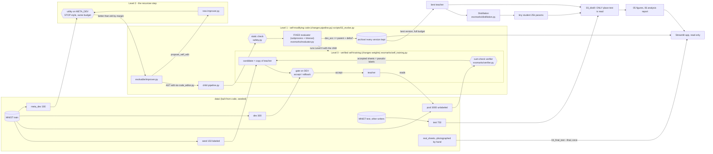

# Architecture

## The whole system in one picture

## Who may read / edit what

| Component | Reads | Writes / edits |
|---|---|---|
| Level 0 loop (`self_training.py`) | seed (labels), pool **images only**, dev (scoring) | model weights in memory |
| Audit (`_audit`, after the decision) | pool hidden labels | log numbers only, never fed back |
| Improver (`evolvable/improver.py`) | the archive records, source of a parent | returns new source text (`pipeline.py` or its own) |
| Static check (`safety.check`) | candidate source | nothing |
| Evaluator (`evaluator.py`) | seed, pool, dev, meta_dev (never test) | `metrics.json`, `model.pt` in the version's archive folder |
| `02_evolve.py` | everything under `archive/` | `archive/`, `results/ablation/`, `results/evolution_summary.json` |
| `03_distill.py` | best/v000 models, seed, pool, dev, **test (only here)** | `results/distill_results.json`, `results/students/` |
| `04_final_test.py --final` | `data/real_sheets/` (once) | `results/final_test.json`, `results/FINAL_TEST_DONE` |
| Figures / report / app | `archive/`, `results/` | `results/figures/`, `results/*.md` (app writes nothing) |

| Path | Who may change it |
|---|---|
| `evolvable/pipeline.py`, `evolvable/improver.py` | the two seed files; evolved versions are written **to `archive/`** (the seeds stay as v000) |
| `archive/`, `results/` | the loops (versions, logs) |
| `evomarks/`, `config.py`, `tests/`, `data/generated/` | **nobody at run time**: SHA-256 before and after every evaluation, abort on mismatch |

## Data splits and who is allowed to see them

| Split | Source | Size (default / quick) | Used for |
|---|---|---|---|
| seed | MNIST train | 150 / 60 sheets (labeled) | first teacher training |
| pool | MNIST train | 3000 / 800 (unlabeled) | Level 0 pseudo-labelling |
| dev | MNIST train | 300 / 120 | Level 0 gate, Level 1 fitness, T/alpha sweep |
| meta_dev | MNIST train | 300 / 120 | Level 2 improver gate **only** (reporting meta_acc) |
| test | MNIST **test** (other writers) | 750 / 300 | reporting only (`03_distill.py`) |
| real_sheets | phone photos | 5-10 sheets | final, once |

Each MNIST image appears in exactly one split (asserted in `01_generate_sheets.py`, tested in `tests/`).
(`n_test` is 750, not 1000: 1000 sheets would need about 1300 images of the digit 1, and MNIST test has 1135.)

## Data flow of one Level 1 generation (`level1_step`)

1. `improver.choose_parent(records, rng)` picks an accepted version (tournament by dev accuracy).
2. `improver.propose_child(parent_source, rng)` applies one AST operator (`code_editor.apply_operator`).
3. `safety.check(source)`: imports whitelist, forbidden names, required definitions. Fail -> stored as rejected `unsafe:<why>`.
4. `evaluator.run(folder)`: sandboxed subprocess with timeout; runs Level 0 with the child under the fixed evolution budget;
   protected files are hashed before/after.
5. Accept iff `dev_acc >= parent.dev_acc + min_delta`. Either way the version stays in `archive/` with its reason.
