# EvoMarks analysis report

Mode: full. All numbers below are read from `results/` and `archive/`; dev/meta_dev numbers were used for selection, test numbers are reporting only.

## Results table (test split)

| model | digit_acc (test) | sheet_exact_read | flag_precision | flag_recall | params | size_KB | latency_ms/sheet | seeds |
|---|---|---|---|---|---|---|---|---|
| teacher v000 (no loops) | 0.8869 | 0.4347 | 0.0812 | 0.9459 | 52138 | 206.8 | 0.58 | 1 |
| teacher v000 (+L0) | 0.9436 | 0.6693 | 0.1381 | 1.0000 | 52138 | 206.8 | 0.82 | 1 |
| teacher best (evolved) | 0.9455 | 0.6827 | 0.1434 | 1.0000 | 81019 | 319.6 | 0.87 | 1 |
| student hard-label | 0.9059 +- 0.0024 | 0.5031 +- 0.0063 | 0.0950 +- 0.0016 | 0.9910 +- 0.0127 | 25450 | 101.7 | 0.26 +- 0.08 | 3 |
| student distilled <- v000 | 0.9105 +- 0.0064 | 0.5253 +- 0.0245 | 0.0997 +- 0.0046 | 1.0000 +- 0.0000 | 25450 | 101.7 | 0.31 +- 0.02 | 3 |
| student distilled <- best | 0.9091 +- 0.0013 | 0.5164 +- 0.0033 | 0.0976 +- 0.0017 | 0.9910 +- 0.0127 | 25450 | 101.7 | 0.35 +- 0.15 | 3 |

## Level 0: verified self-training

- **v000**: dev accuracy 0.8905 -> 0.9481 (+0.0576; helped). 3 of 3 rounds accepted, 0 rolled back.
  - sum check accepted 938/1800 sheets; pseudo-label precision 0.9944; 19 accepted sheets contained compensating errors; 188 accepted digits were low-confidence (<0.6), of which 175 were correct.
  - confidence-threshold ablation (each digit >= 0.9): kept 9447 digits (sum check kept 6566), pseudo-label precision 0.9683 (sum check 0.9944), final dev accuracy 0.9276 vs 0.9481 for the sum check (sum check better).
- **best**: dev accuracy 0.8181 -> 0.9481 (+0.1300; helped). 2 of 3 rounds accepted, 1 rolled back.
  - sum check accepted 825/1800 sheets; pseudo-label precision 0.9861; 39 accepted sheets contained compensating errors; 310 accepted digits were low-confidence (<0.6), of which 266 were correct.
  - confidence-threshold ablation (each digit >= 0.9): kept 8817 digits (sum check kept 5775), pseudo-label precision 0.9754 (sum check 0.9861), final dev accuracy 0.9405 vs 0.9481 for the sum check (sum check better).

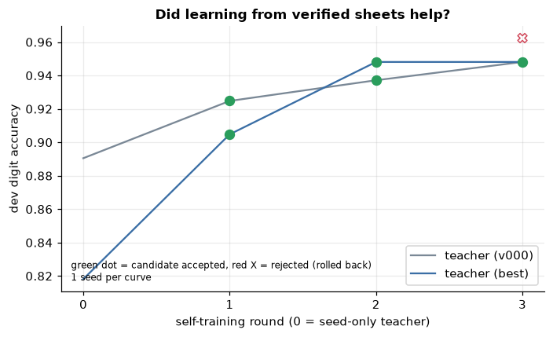
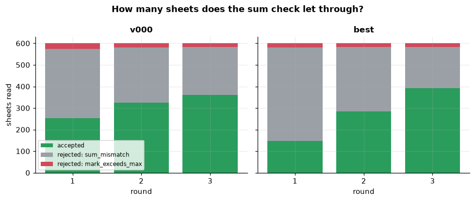
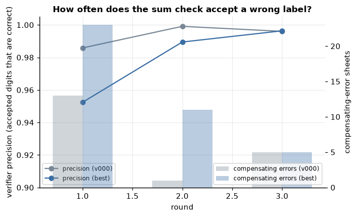
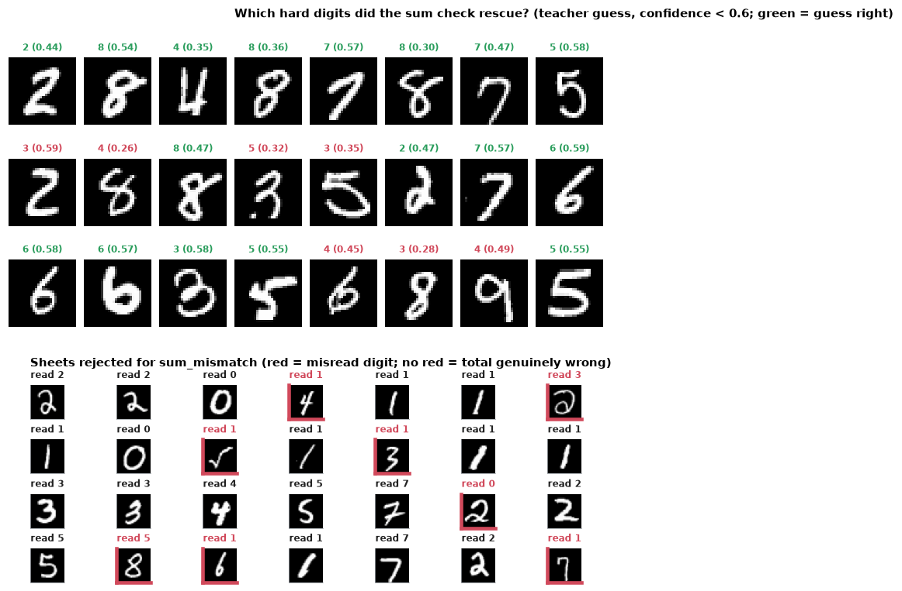
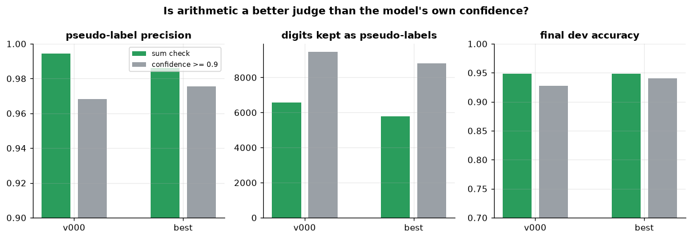
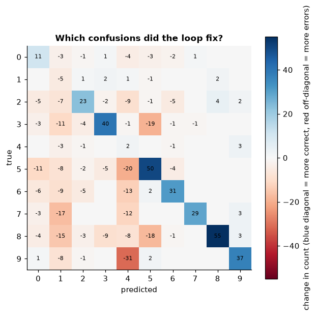

## Level 1: self-modifying code

- 20 candidate versions in 20 generations; 2 accepted, 18 rejected (no_improvement: 18, ok: 0).
- Best version v016: dev 0.9286 -> 0.9581 (+0.0295); the dev gain is optimistic because v016 was *selected* on dev. On meta_dev (not used for this selection) 0.9433 -> 0.9581 (+0.0148, helped).
- Edit effectiveness (mean change in dev accuracy vs parent):
  - add_block: n=10, accepted 1, mean delta -0.0138
  - remove_block: n=1, accepted 0, mean delta -0.0229
  - resize_model: n=3, accepted 1, mean delta -0.0198
  - tweak_constant: n=6, accepted 0, mean delta -0.0053

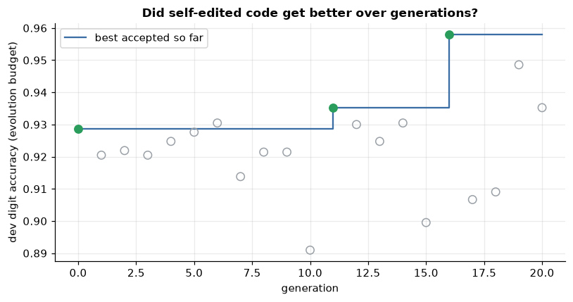
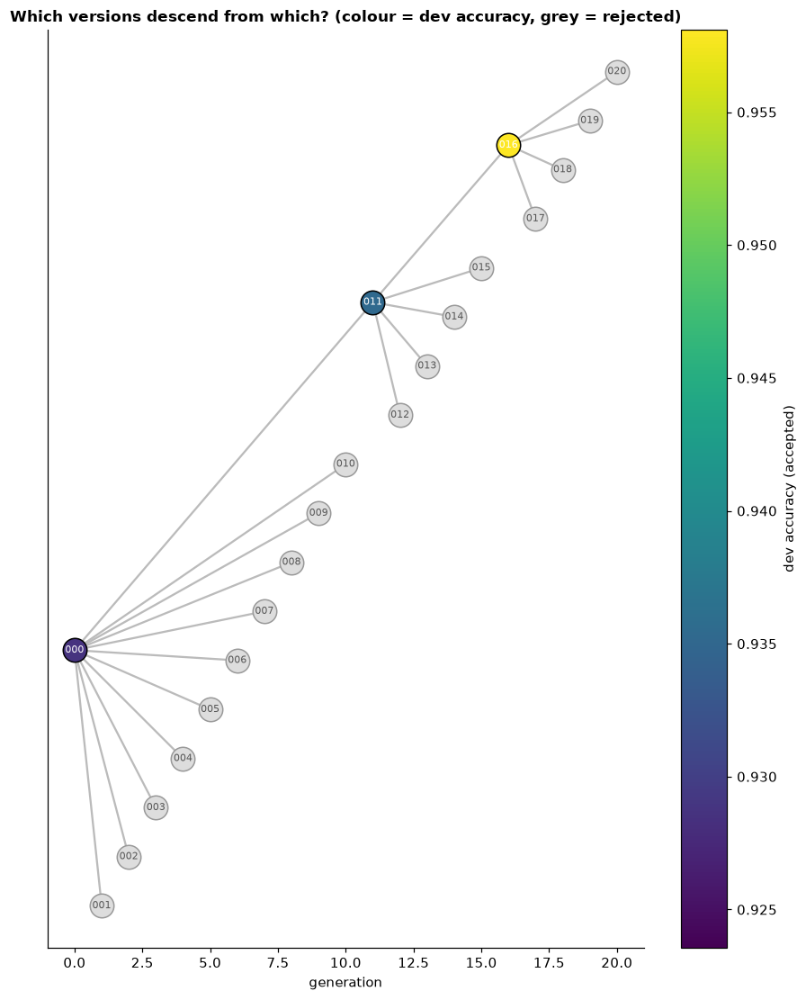
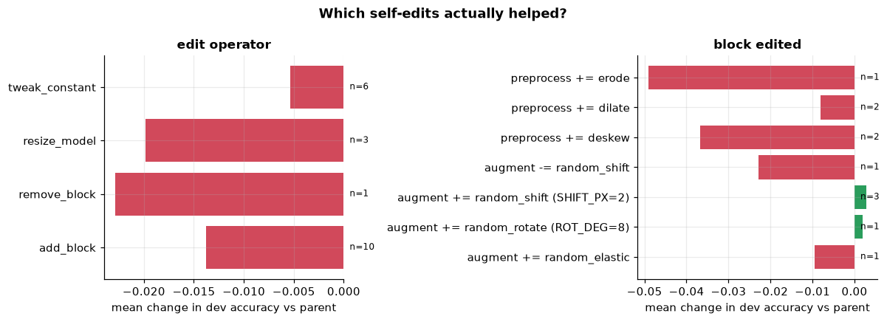
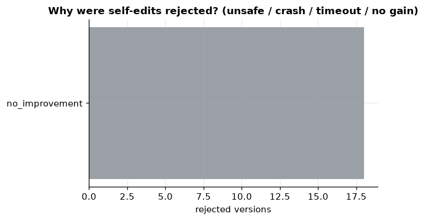
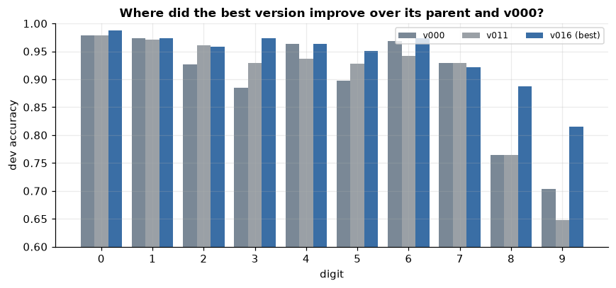

## Level 2: the improver improving itself

- 3 self-edit proposals, 0 accepted.
  - gen 5: improver self-edit: PARENT_SELECTION tournament -> recent -> utility +0.0000 -> +0.0000 (rolled back: utility_not_better)
  - gen 10: improver self-edit: PARENT_SELECTION tournament -> best -> utility -0.0035 -> -0.0035 (rolled back: utility_not_better)
  - gen 15: improver self-edit: OPERATOR_WEIGHTS['tweak_constant'] 1.0 -> 0.67381 -> utility +0.0038 -> +0.0038 (rolled back: utility_not_better)
- Ablation (best dev accuracy after the last generation, mean over 3 seed(s)): Level 1 + 2 = 0.9538, Level 1 only = 0.9538 (difference +0.0000). With so few runs, a difference this small cannot be separated from evaluation noise unless it exceeds ~2 standard errors.

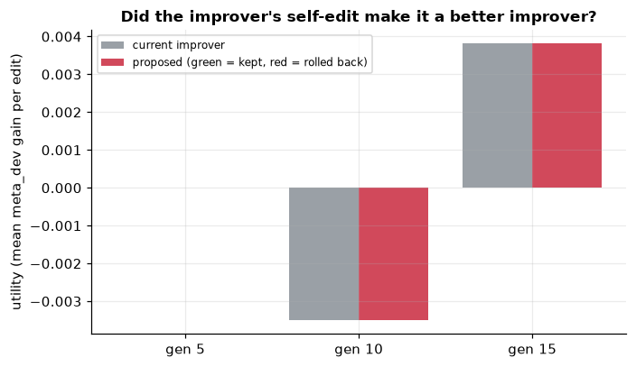
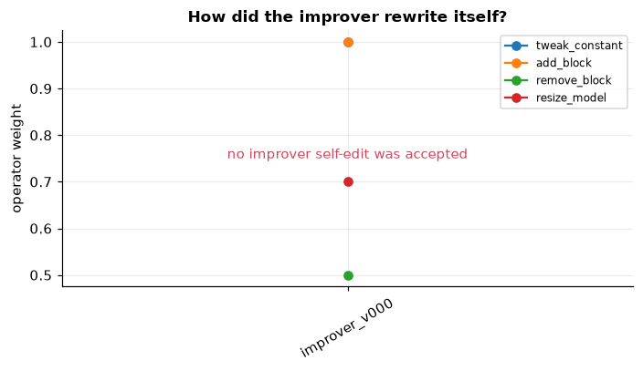
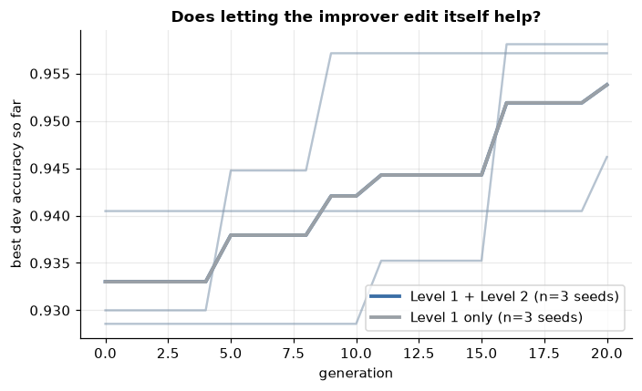

## Distillation

- Chosen on dev: v000: T=2, alpha=0.3, best: T=1, alpha=0.7.
- Test digit accuracy (mean +- std over 3 seeds): hard-label student 0.9059 +- 0.0024; distilled from v000 0.9105 +- 0.0064; distilled from best 0.9091 +- 0.0013; teacher best 0.9455.
- Distillation vs hard-label (best teacher): +0.0032 -> no clear effect (within 2 standard errors).
- Size/speed: student 25450 params / 102 KB / 0.20 ms per sheet vs teacher 81019 params / 320 KB / 0.87 ms (3.2x fewer params, 4.3x faster).
- Teacher minus distilled student, test digit accuracy: +0.0364.
- Largest per-digit gap (teacher - distilled student): digit 9 (+0.215); the average hides this tail.

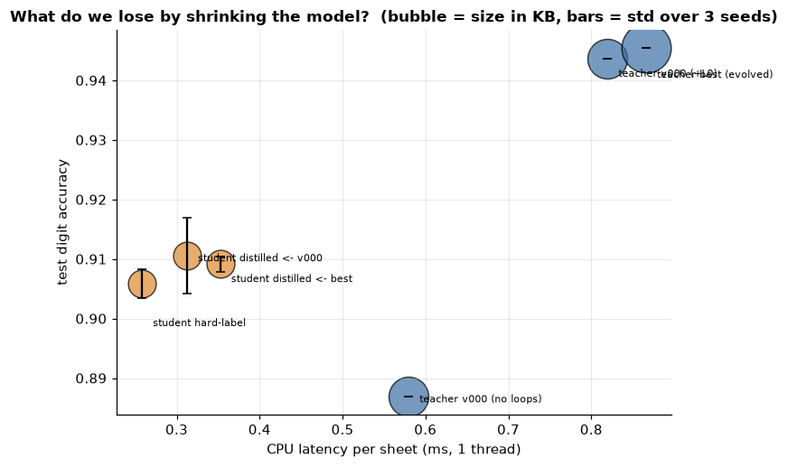
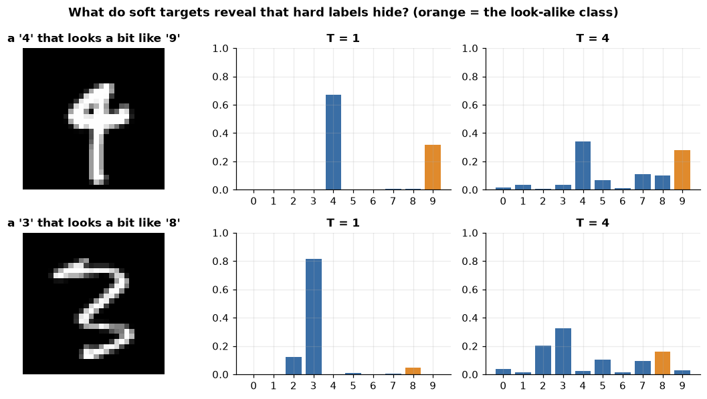
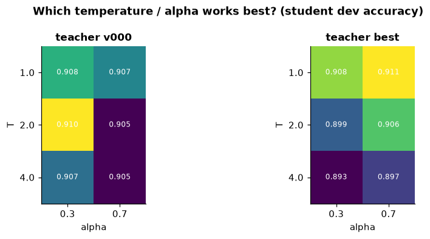
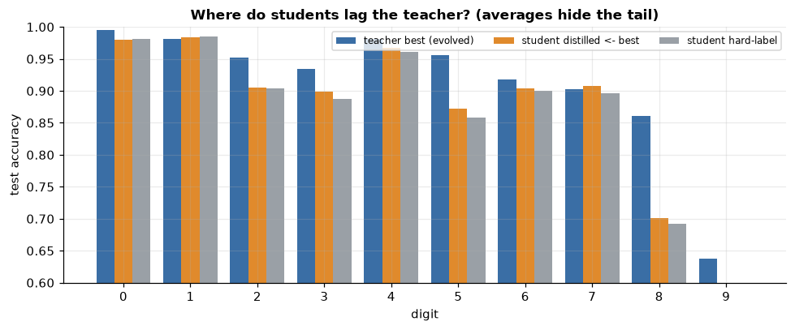

## Whole system

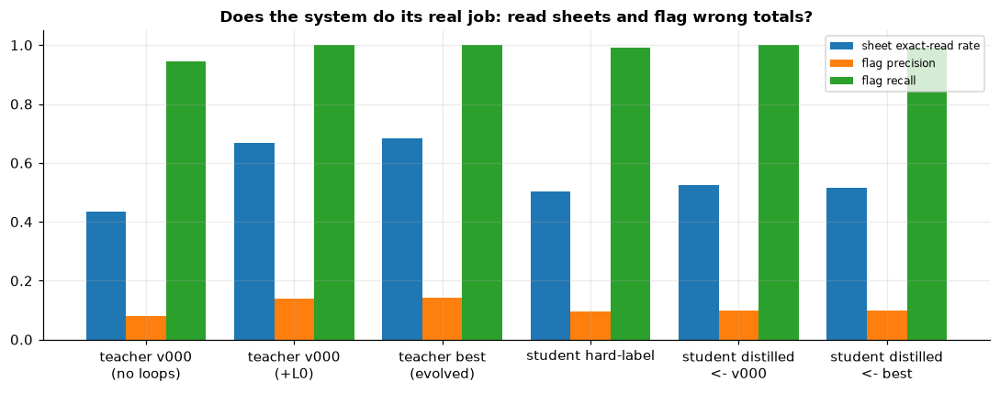
